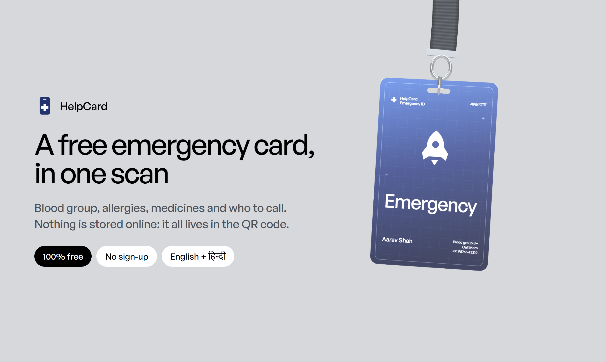
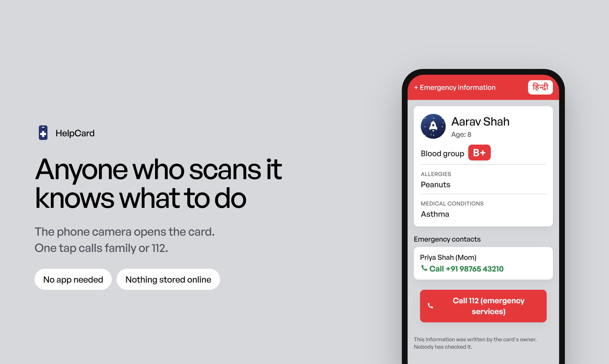

<p align="center"></p>

# HelpCard

**A free emergency QR card, in one scan.** Make one at **[helpcard.nuvolin.com](https://helpcard.nuvolin.com)**.

Blood group, allergies, medicines and who to call, for anyone who finds you or your child. Print it as a wallet card,
a lanyard badge or stickers for a helmet or school bag. Whoever scans it sees the details and can call family or 112
in one tap. English and Hindi.






## Brand assets

All in [`brand/`](brand/). Navy `#22336e`, ink `#000000`, grey `#d6d8dc`; type is General Sans 500.

| Symbol | Symbol, one colour | Symbol, reversed |
|:-:|:-:|:-:|
|  |  |  |

| Logo | Logo, one colour | Logo on navy | Logo on grey |
|:-:|:-:|:-:|:-:|
|  |  |  |  |

Product Hunt thumbnail: [`brand/thumbnail.png`](brand/thumbnail.png). The logo files are generated by
[`brand/build.py`](brand/build.py).

## Nothing is stored online

There is no account and no database. The card's details are packed into the QR link itself (after the `#`, which
browsers never send to a server), and the page decodes them in the browser. See [`lib/card.ts`](lib/card.ts).

## How it runs

- **Next.js static export** (`out/`), no server code.
- **Google Cloud Run** serves the site: nginx in a small container ([`Dockerfile`](Dockerfile), [`nginx.conf`](nginx.conf)),
  scaling from zero to one instance.
- **Cloudflare** in front ([`edge/worker.js`](edge/worker.js)): forwards pages to Cloud Run, caches them for 10 minutes,
  and serves its own copy of the same build if Cloud Run is unreachable, so printed cards keep working.
- The 3D lanyard on the home page is three.js with a small rope simulation ([`components/Lanyard3D.tsx`](components/Lanyard3D.tsx)).

## Run it locally

```bash
npm ci
npm run dev      # http://localhost:3000
npm run build    # static site in out/
```

---

HelpCard is not a medical service. In an emergency in India, call 112. Made by [Nuvolin](https://nuvolin.com).
