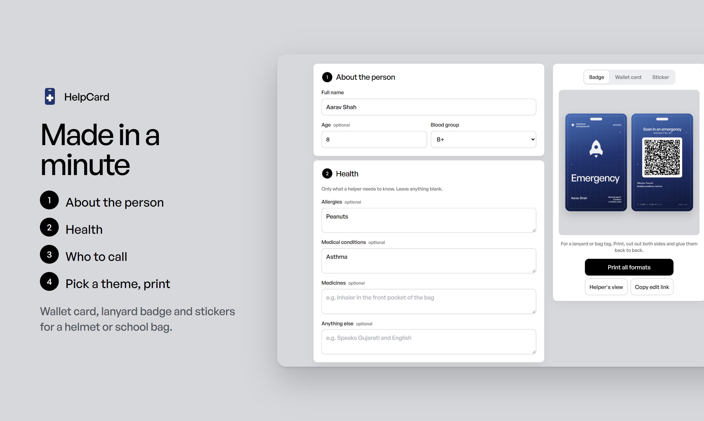
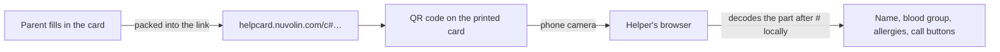
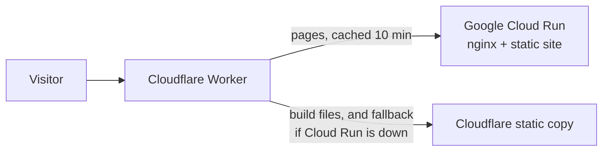
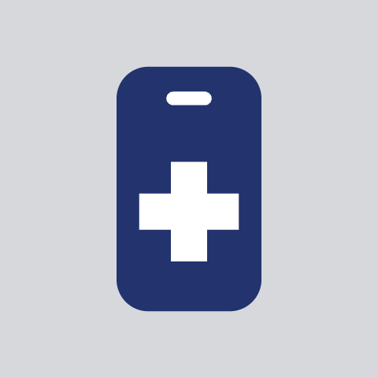
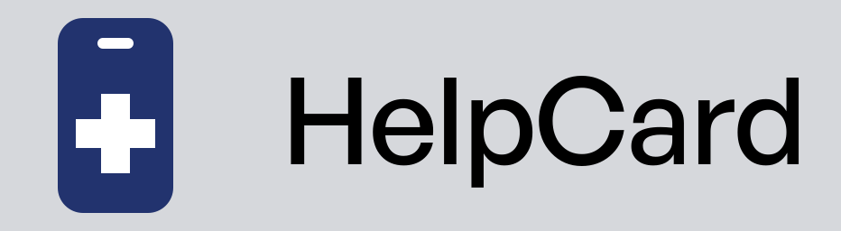

<div align="center">

<a href="https://helpcard.nuvolin.com"></a>

# HelpCard

**A free emergency QR card, in one scan.**

Blood group, allergies, medicines and who to call, for anyone who finds you or your child.

[](https://helpcard.nuvolin.com)
[](LICENSE)
[](#how-it-runs)
[](https://nextjs.org)

<a href="https://www.producthunt.com/products/helpcard?embed=true&utm_source=badge-featured&utm_medium=badge&utm_campaign=badge-helpcard" target="_blank" rel="noopener noreferrer"></a>

**[Make your card →](https://helpcard.nuvolin.com)**

<br>


</div>

<br>

## Why HelpCard

In an accident, the people around you are strangers. A scared child may not remember a phone number or an allergy.
HelpCard puts the answers on a card: anyone who scans it sees what to watch out for and can call family in one tap.

<table>
  <tr>
    <td width="33%" valign="top">
      <h3>Free, no sign-up</h3>
      Fill in four short steps, print, done. No account, no app, no payment.
    </td>
    <td width="33%" valign="top">
      <h3>Nothing stored online</h3>
      The details live inside the QR code itself. There is no database to leak.
    </td>
    <td width="33%" valign="top">
      <h3>English and हिन्दी</h3>
      The page a helper sees comes in English or Hindi, with one-tap calls to family or 112.
    </td>
  </tr>
  <tr>
    <td valign="top">
      <h3>Three formats</h3>
      Wallet card, two-sided lanyard badge, and round stickers for a helmet or school bag.
    </td>
    <td valign="top">
      <h3>Made for kids</h3>
      Six themes, twelve icons and an optional photo that never leaves your device.
    </td>
    <td valign="top">
      <h3>Printed cards keep working</h3>
      Served by Cloud Run with a Cloudflare fallback, so a QR printed today still opens.
    </td>
  </tr>
</table>

## See it

<table>
  <tr>
    <td width="50%"></td>
    <td width="50%"></td>
  </tr>
  <tr>
    <td align="center"><sub><b>Make it</b> in four short steps, with a live preview of every format.</sub></td>
    <td align="center"><sub><b>Scan it</b> with a phone camera: the details and a call button.</sub></td>
  </tr>
</table>

## How it works



The card's details are turned into short JSON, compressed (`deflate-raw`) and base64url-encoded into the part of the
link after `#`. Browsers never send that part to a server, so the details are only ever read on the phone that scans
the card. The code is in [`lib/card.ts`](lib/card.ts).

## How it runs



| Part | What it does | Files |
|---|---|---|
| **Next.js static export** | The whole site is static files in `out/`, no server code | [`next.config.ts`](next.config.ts) |
| **Google Cloud Run** | nginx in a small container serves the site, scaling from zero to one instance | [`Dockerfile`](Dockerfile), [`nginx.conf`](nginx.conf) |
| **Cloudflare Worker** | Front door on `helpcard.nuvolin.com`: forwards pages to Cloud Run, caches them, falls back to its own copy | [`edge/worker.js`](edge/worker.js), [`wrangler.jsonc`](wrangler.jsonc) |
| **three.js** | The 3D lanyard badge on the home page, with a small rope simulation | [`components/Lanyard3D.tsx`](components/Lanyard3D.tsx) |
| **Canvas badge art** | Draws the badge's front and back, used on screen and for printing | [`lib/badgeArt.ts`](lib/badgeArt.ts) |

## Run it locally

```bash
git clone https://github.com/khalidmemon1/helpcard.git
cd helpcard
npm ci
npm run dev      # http://localhost:3000
npm run build    # static site in out/
```

## Brand

Navy `#22336e` · Ink `#000000` · Grey `#d6d8dc` · Type: [General Sans](https://www.fontshare.com/fonts/general-sans) 500.
All files are in [`brand/`](brand/), generated by [`brand/build.py`](brand/build.py).

<table>
  <tr>
    <td align="center"><br><sub>Symbol</sub></td>
    <td align="center"><br><sub>One colour</sub></td>
    <td align="center"><br><sub>Reversed</sub></td>
    <td align="center"><br><sub>Thumbnail</sub></td>
  </tr>
</table>

<table>
  <tr>
    <td align="center"><br><sub>Logo</sub></td>
    <td align="center"><br><sub>One colour</sub></td>
  </tr>
  <tr>
    <td align="center"><br><sub>On navy</sub></td>
    <td align="center"><br><sub>On grey</sub></td>
  </tr>
</table>

## License

[MIT](LICENSE) © 2026 Nuvolin. The HelpCard name and logo identify this project; please use your own name and logo
for a fork.

<br>

<div align="center">

**HelpCard is not a medical service.** In an emergency in India, call **112**.
Check the card's details yourself, and make a new one when they change.

<sub>Made by <a href="https://nuvolin.com">Nuvolin</a> · <a href="https://helpcard.nuvolin.com">helpcard.nuvolin.com</a></sub>

</div>
